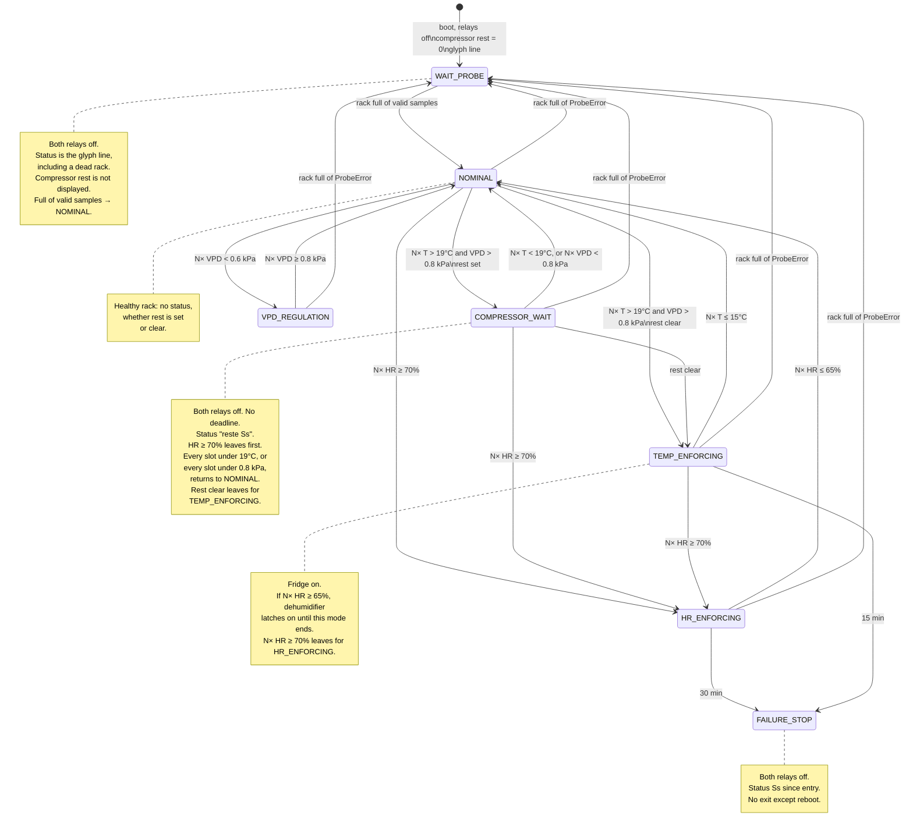

# Implementation prompt

Implement the cabinet controller in this crate. The cabinet is a closed, well-insulated volume in a cellar of about 18°C or lower. It holds vegetal material, which releases moisture into the air. There is no heater. The only actuators are a fridge compressor and a Peltier dehumidifier.

Replace the placeholder loop in `src/bin/main.rs`. The crate is already an ESP32, `no_std`, `no_main` Embassy firmware on `esp-hal` 1.1 and `esp-rtos`. Keep that runtime, the bootloader application descriptor, and the existing Clippy denies. Status text is a static string or a fixed-capacity formatted line. Do not allocate a heap `String`.

Follow the build order below. Do not start a step until the previous step's tests pass. For every step, write the unit tests or integration tests first, confirm they fail, then write the production code that makes them pass. Host tests run with `cargo test` and do not need the chip. The mode decision stays a pure function of the samples, the current mode, the dehumidifier latch, the rest flag, and the elapsed deadlines. The binary only reads the probe, applies that decision to the relays, and publishes state for the display.

## Build order

### 1. `SampleRack`

Write unit tests for the rack before implementing it:

- An empty rack is incomplete: every slot is `None`.
- Pushing `Ok(ProbeMeasure)` or `Err(ProbeError)` fills the next slot and leaves the other slots in place.
- The rack is healthy only when every slot is `Ok`, sick when at least one slot is `Err` and at least one is not, and dead when every slot is `Err`.
- A threshold is met only when all N slots satisfy it. One slot that misses it rejects the threshold.
- The glyph line is one mark per slot, separated by a single space: `*` valid, `?` missing, `!` error. Its length is `2N - 1`.

Then implement `ProbeMeasure`, `ProbeError`, and `SampleRack`.

### 2. Display and `RelayBank` traits and their host implementations

`RelayBank` is the logical relay state. `RelayOutput` is the trait that applies that state to pins. `Panel` is the display trait. This step adds those types and the in-memory implementations the later tests will use. It does not open GPIO pins or the SSD1306.

Write the tests before those implementations:

- `RelayBank` uses `false` for off and `true` for on. `sw3` and `sw4` stay off.
- A recording `RelayOutput` stores the fridge and dehumidifier commands from `apply`. Mapping a logical on to a pin low, and a logical off to a pin high, is checked on that fake. No GPIO register is touched.
- A `Panel` draw into `embedded-graphics`' `MockDisplay` shows the yellow-band title, a filled triangle for a relay that is on, a 1-pixel outline for a relay that is off, and the status line. A failed probe does not invent a temperature.

Then implement `RelayBank`, `RelayOutput`, `Panel`, the recording relay, and the `MockDisplay` draw path.

### 3. `AppState`

Write unit tests before the struct:

- Boot state is `WaitProbe`, every relay off, compressor rest clear, and an empty rack.
- Rest becomes active only after a fridge on-to-off edge, and it stays active for 600 s from that edge. Turning the fridge off while it is already off does not move the edge timestamp.
- `status_line` can hold `reste 600s` and a glyph line of length `2N - 1`. `reste 600s` is 10 bytes.

Then implement `AppState`.

### 4. `MainActor` and the modes

Write the host tests listed in "Done when" before the actor or any mode struct. Drive them with a fake `ClimateProbe` and the recording `RelayOutput` from step 2. They do not construct a panel.

Then implement `ApplicationMode`, `WaitProbeMode`, `NominalMode`, `CompressorWaitMode`, `TempEnforcingMode`, `VpdRegulationMode`, `HrEnforcingMode`, `FailureStopMode`, and `MainActor::step`. After those tests pass, add the binary's GPIO `RelayOutput`. Its first output level on GPIO14, GPIO27, GPIO26, and GPIO25 is high.

### 5. The real display

The frame tests from step 2 already cover drawing. Add an integration test that `DisplayActor` redraws only when the published `AppState` changes, using `MockDisplay` as the `Panel`.

Then implement the SSD1306 `Panel` and the Embassy display task on the shared I2C bus. This is the only step that constructs the panel. The firmware build for this crate's ESP32 target is the check that the real panel and the pin adapter compile into the binary.

## What the controller must hold

Keep vapor-pressure deficit (VPD) between 0.6 kPa and 0.8 kPa, and keep relative humidity from staying above 70%.

VPD in kPa is `es(T) * (1 - HR / 100)`, with saturation vapor pressure `es(T) = 0.6108 * exp(17.27 * T / (T + 237.3))` and `T` in degrees Celsius. Compute one VPD for each stored sample. Do not average temperature and humidity first and then compute a single VPD.

The fridge compressor lowers temperature, raises humidity, and lowers VPD. It must rest after every run. The Peltier dehumidifier lowers humidity, raises temperature, and raises VPD. The Peltier needs no rest.

## Modes

Start in `WAIT_PROBE` on every boot, with both relays off and compressor rest set to 0. Rest lives in RAM. Start a fresh 600-second rest on each falling edge of the fridge output: the compressor was on, and this decision turns it off. Commanding the fridge off while it is already off does not restart the timer. Rest blocks only the start of `TEMP_ENFORCING`: a hot, dry rack enters `COMPRESSOR_WAIT` until rest clears. Rest does not block `HR_ENFORCING`, including from `COMPRESSOR_WAIT`, and it does not block turning the fridge off.

A threshold changes a mode only when the sample rack is healthy and every stored sample meets that threshold. The rack is a `heapless::HistBuf` of capacity N, so the check covers all N slots. The rack starts empty (`None` in every slot), so boot stays in `WAIT_PROBE` with both relays off and the glyph line on the status until every slot is a valid sample, then switches to `NOMINAL`. A failed read is pushed as `ProbeError` and does not clear the other slots.

In every mode except `FAILURE_STOP`, inspect the rack before that mode's own rules. If every slot is `ProbeError`, the rack is dead: enter `WAIT_PROBE` with both relays off. If the fridge was on, that falling edge starts compressor rest. If the rack contains a `ProbeError` but is not full of them, the rack is sick: take no decision until every slot is a valid sample again. Hold the current mode and both relay commands, and show the glyph line. Deadline clocks keep running, but do not apply a deadline, a threshold, or any other transition while the rack is sick. `FAILURE_STOP` does not consult the rack.

`NOMINAL` tests these conditions against all N slots, and stops at the first match:

1. Humidity at or above 70% → `HR_ENFORCING`.
2. Temperature above 19°C and VPD above 0.8 kPa, and rest is clear → `TEMP_ENFORCING`.
3. Temperature above 19°C and VPD above 0.8 kPa, and rest is set → `COMPRESSOR_WAIT`. Do not fall through to `VPD_REGULATION`. Do not start the cooling deadline.
4. VPD under 0.6 kPa → `VPD_REGULATION`. At 19°C this VPD already requires about 73% relative humidity, so rule 1 has already taken those cases.
5. Otherwise both relays off. This includes VPD above 0.8 kPa while temperature is at or below 19°C. Leave the vegetal material to release moisture and bring VPD down. There is no end-of-cycle mode and no extra actuator.

With a healthy rack, `NOMINAL` clears the status line. It does not display compressor rest, whether rest is set or clear. Do not leave a previous mode's text in place.

`COMPRESSOR_WAIT` holds a hot, dry cabinet until the compressor may start. Both relays stay off. It has no deadline, so this wait does not count toward the 15 minutes of `TEMP_ENFORCING`. The yellow title is `ATT. COMPRESS.`. On a healthy rack it tests these conditions, in this order:

1. Humidity at or above 70% → `HR_ENFORCING`. This pre-empts the wait, including on the sample where rest clears. The fridge is already off, so the handoff does not restart rest and does not turn the compressor on for that sample.
2. All N slots have temperature under 19°C, or all N slots have VPD under 0.8 kPa → `NOMINAL`. One slot at or above 19°C rejects the temperature return. One slot at or above 0.8 kPa rejects the VPD return. Temperature equal to 19°C does not count as under 19°C, and VPD equal to 0.8 kPa does not count as under 0.8 kPa. A mix, some slots cool and others less dry, stays: one slot meeting one side is not a decision. A rack that has recovered enough for `VPD_REGULATION` returns here first; `NOMINAL` applies its own rules on that same sample.
3. Rest clear → `TEMP_ENFORCING`. This is the rack that failed rule 2: it is not unanimously under 19°C and not unanimously under 0.8 kPa. The cooling deadline starts at that entry, when the compressor starts.
4. Otherwise stay. Status `reste {S}s`, with S the whole seconds of rest still remaining. That is the rest countdown, not the time spent in this mode.

`HR_ENFORCING` is the humidity emergency. Fridge off, dehumidifier on, for the whole mode. Leave for `NOMINAL` when all N samples show humidity at or below 65%. If the mode has lasted 30 minutes since this entry, go to `FAILURE_STOP`. The 30 minutes are counted from this entry, including an entry that came from `TEMP_ENFORCING` or `COMPRESSOR_WAIT`.

`TEMP_ENFORCING` cools the cabinet. Fridge on. The first time all N samples show humidity at or above 65%, turn the dehumidifier on and keep it on until this mode ends, even if humidity later falls below 65%. Inside this mode, test humidity before the other exits. All N samples at or above 70% go to `HR_ENFORCING` even if temperature has also reached 15°C or the 15-minute deadline has also elapsed. That handoff turns the fridge off, so it starts compressor rest, and it starts a new 30-minute `HR_ENFORCING` deadline. Rest does not block the handoff. If humidity is still under 70%, leave for `NOMINAL` when all N samples show temperature at or below 15°C. If the mode has lasted 15 minutes since the compressor actually started, go to `FAILURE_STOP`.

`VPD_REGULATION` raises a VPD that is under 0.6 kPa. Fridge off, dehumidifier on, for the whole mode. Leave for `NOMINAL` when all N samples show VPD at or above 0.8 kPa. This mode has no deadline.

`WAIT_PROBE` is the initial mode, and it is the mode entered when the sample rack is dead. On boot the rack is empty: stay here with both relays off and the glyph line on the status until every slot holds a valid sample, then switch to `NOMINAL` and evaluate those samples. The same exit applies after a dead rack. Leave for `NOMINAL` only when every slot is a valid sample. Do not resume the mode that was interrupted. Re-evaluate `NOMINAL` from those samples. From an operating mode other than `FAILURE_STOP`, enter `WAIT_PROBE` when every slot is `ProbeError`. There is no timed probe-outage delay. The yellow title is `ATT. SONDE`. The status line is the glyph line for the whole mode, including a dead rack. Do not display compressor rest here, even when the entry turned the fridge off and started rest.

`FAILURE_STOP` means `TEMP_ENFORCING` or `HR_ENFORCING` exceeded its deadline. Yellow title `ÉCHEC / ARRÊT`. Both relays off. The status line is `{S}s`, the whole seconds since this entry. No transition leaves this mode. Only a reboot does, and that reboot starts in `WAIT_PROBE` with compressor rest clear and the glyph line.

Deadlines start when the mode is entered, not while rest is holding the controller in `COMPRESSOR_WAIT`, and not while boot is still filling the rack in `WAIT_PROBE`. Turning the fridge off on the way into `WAIT_PROBE` or `FAILURE_STOP`, or on the way from `TEMP_ENFORCING` to `HR_ENFORCING`, is a falling edge and starts rest. `WAIT_PROBE` does not display that rest: its status line stays the glyph line. Entering `COMPRESSOR_WAIT` from `NOMINAL` commands a fridge that is already off, so it does not restart rest.



| Mode | Yellow title | Fridge | Dehumidifier | Leave when |
| --- | --- | --- | --- | --- |
| `WAIT_PROBE` | `ATT. SONDE` | off | off | every slot a valid sample → `NOMINAL`. Status is the glyph line, including a dead rack. Compressor rest is not displayed |
| `NOMINAL` | `NOMINAL` | off | off | the ordered rules above. Healthy rack: empty status, whether rest is set or clear |
| `COMPRESSOR_WAIT` | `ATT. COMPRESS.` | off | off | N× HR ≥ 70% → `HR_ENFORCING`, else N× T < 19°C or N× VPD < 0.8 kPa → `NOMINAL`, else rest clear → `TEMP_ENFORCING`. Healthy rack: `reste {S}s`. No time limit |
| `HR_ENFORCING` | `FORÇAGE HYGRO.` | off | on | N× HR ≤ 65%, or 30 min → `FAILURE_STOP` |
| `TEMP_ENFORCING` | `FORÇAGE TEMP.` | on | on after N× HR ≥ 65%, then latched | N× HR ≥ 70% → `HR_ENFORCING`, else N× T ≤ 15°C, or 15 min → `FAILURE_STOP` |
| `VPD_REGULATION` | `RÉGUL. HYGRO.` | off | on | N× VPD ≥ 0.8 kPa. No time limit |
| `FAILURE_STOP` | `ÉCHEC / ARRÊT` | off | off | reboot only. Status `{S}s` since this entry |

## Probe

One SHT31 on I2C address `0x44`, shared with the display. Use the single-shot, high-repeatability command with clock stretching disabled: write the two bytes `0x24` then `0x00`. Do not use the `0x2C` clock-stretch family. The ESP32 I2C master can hang on those commands.

Wait 16 ms, then read six bytes: temperature MSB, temperature LSB, temperature CRC, humidity MSB, humidity LSB, humidity CRC. The CRC-8 covers each pair of data bytes. It starts at `0xFF`, uses polynomial `0x31`, and shifts the high bit out first. Reject the sample if either CRC fails.

Convert the big-endian raw words with `T = raw_t * 175 / 65535 - 45` in degrees Celsius and `HR = raw_rh * 100 / 65535` in percent. A failed write, a failed read, and a bad CRC are the same kind of failure for the state machine: push `Err(ProbeError)` into the next sample-rack slot. A good sample pushes `Ok(ProbeMeasure)`. Neither replaces the rest of the rack.

Take one sample about once per second. Log temperature, humidity, VPD, mode, both relay commands, and whether compressor rest is active.

## Relays and pins

I2C0 at 400 kHz. SDA is GPIO21. SCL is GPIO22.

The fridge is SW1 on GPIO14. The dehumidifier is SW2 on GPIO27. SW3 on GPIO26 and SW4 on GPIO25 are present on the same board and must be driven off for the whole run.

The relays are active-low. The idle, safe level is high. The first output configuration drives all four pins high, before the first sample and before the display task starts. A later panic must not be able to leave a relay on because the pins were never initialized.

Do not use the flash pins GPIO6 through GPIO11, nor GPIO16 or GPIO20. Do not put a relay on GPIO12: it is a strap pin, high impedance at reset, and it selects the flash voltage.

Run Embassy from timer group 0, as the crate already does.

## Display

SSD1306, 128×64, I2C address `0x3C`, on the same master as the probe. Give the display and the probe each their own handle to one shared bus. Use buffered graphics, rotation 0. Initialize the panel before the first frame. A display task redraws only when the published state changes, and it wakes about every 100 ms to check.

The panel's top 16 rows are the yellow band. Draw the mode title there in the 6×10 Latin-1 font, a few pixels from the left and vertically centered in the band. On the right of the same band, draw two triangles, each 10 pixels wide and 10 pixels tall, 4 pixels apart, 4 pixels in from the right edge. The right-hand triangle points down and means the fridge. The left-hand one points up and means the dehumidifier. Fill the triangle when that relay is on. Draw only a 1-pixel outline when it is off. Center both triangles vertically in the yellow band.

`ATT. COMPRESS.` and `FORÇAGE HYGRO.` are the longest titles. Each is 14 characters. At 6 pixels per character, starting at x = 4, the 16th character of a title ends as it meets the left triangle. Do not lengthen a title that far. The other titles are `NOMINAL`, `FORÇAGE TEMP.`, `ATT. SONDE`, `RÉGUL. HYGRO.`, and `ÉCHEC / ARRÊT`.

Directly under the yellow band, one 6×10 status line. The current mode always sets it.

- Except in `FAILURE_STOP`, a sick or incomplete rack shows one mark per slot, separated by a single space. `*` is a valid sample, `?` is `None`, and `!` is `ProbeError`. The line is `2N - 1` characters. Boot is this case: every slot is `None`.
- `WAIT_PROBE` shows that glyph line for the whole mode, including a dead rack. It does not display compressor rest.
- `NOMINAL` with a healthy rack shows an empty status line. It does not display compressor rest, whether rest is running or clear.
- `COMPRESSOR_WAIT` with a healthy rack shows `reste {S}s`, the whole seconds of compressor rest still remaining.
- `TEMP_ENFORCING`, `VPD_REGULATION`, and `HR_ENFORCING` with a healthy rack show `{S}s`, the whole seconds since this entry.
- `FAILURE_STOP` shows `{S}s`, the whole seconds since this entry. The rack does not change this line.

Under the status line, draw temperature and humidity in the 10×20 font: temperature with one decimal and a degree sign, humidity as a rounded integer percent. Under that, draw VPD in the 6×10 font with three decimals and the unit kPa. The whole frame is 64 pixels tall. The status line occupies the gap between the yellow band and the large temperature line, so place VPD high enough that its 10-pixel font ends at or above y = 64. Do not invent a temperature while the probe is failed. The status line is the failure text.

## Dependencies to add

The binary already has Embassy, `esp-hal`, `esp-rtos`, logging, and `static_cell`. Also bring in `embassy-sync`, `embassy-embedded-hal` for an async shared I2C bus, `embedded-hal-async`, `ssd1306` with its async feature, `embedded-graphics`, `heapless`, and `libm`.

The framebuffer is 1024 bytes, and the async I2C futures carry large error types. The crate denies large stack frames. Allow those two sites locally, with a reason. Do not allow the rest of the program.

## Done when

These are the step 4 tests. Write them before `MainActor` and the mode structs. They cover every transition, without hardware:

- Boot starts in `WAIT_PROBE` with both relays off, compressor rest clear, and the glyph line on the status. The rack must fill before `NOMINAL`. A hot, dry cabinet may enter `TEMP_ENFORCING` as soon as the rack is healthy and rest is clear. 
- All N valid samples must meet a threshold before it changes mode. N is the `HistBuf` capacity. One slot that misses the threshold leaves the mode unchanged. While any slot is still `None`, stay in `WAIT_PROBE`.
- `NOMINAL` priority: 70% humidity beats a hot cabinet; a hot, dry rack with rest set enters `COMPRESSOR_WAIT` and does not fall through into `VPD_REGULATION`; VPD under 0.6 kPa with humidity under 70% enters `VPD_REGULATION`; VPD above 0.8 kPa at 19°C or below leaves both relays off. A healthy `NOMINAL` rack shows an empty status line whether rest is set or clear.
- `COMPRESSOR_WAIT` keeps both relays off and shows `reste {S}s`. Humidity at or above 70% goes to `HR_ENFORCING` before the compressor starts, including on the sample where rest clears. All N slots under 19°C return to `NOMINAL`, and so do all N slots under 0.8 kPa. One slot at or above 19°C blocks the temperature return. One slot at or above 0.8 kPa blocks the VPD return. A mix of those two does not return. Exactly 19°C is not under 19°C, and exactly 0.8 kPa is not under 0.8 kPa. Rest clear goes to `TEMP_ENFORCING` and the 15-minute deadline starts then. `COMPRESSOR_WAIT` itself does not time out. A return to `NOMINAL` on a rack under 0.6 kPa continues into `VPD_REGULATION` on that same sample.
- `TEMP_ENFORCING` latches the dehumidifier once humidity has reached 65%, returns to `NOMINAL` at 15°C, and at 70% humidity goes to `HR_ENFORCING` instead, starting rest and a new 30-minute deadline.
- `HR_ENFORCING` returns at 65% humidity and becomes `FAILURE_STOP` at 30 minutes.
- `TEMP_ENFORCING` becomes `FAILURE_STOP` at 15 minutes. `VPD_REGULATION` does not time out. `FAILURE_STOP` has no outgoing transition.
- One `ProbeError` makes the rack sick: the mode and the relays stay, and no deadline fires, until every slot is valid again. When every slot is `ProbeError`, `WAIT_PROBE` forces both relays off and starts rest only if the fridge was actually on. Its status line is the glyph line, not the rest countdown. A rack full of valid samples returns to `NOMINAL` and does not resume the old mode, including `COMPRESSOR_WAIT`. `FAILURE_STOP` does not enter `WAIT_PROBE`.
- Writing fridge-off while the fridge is already off does not extend rest.

The firmware builds for this crate's ESP32 target. The first level driven on GPIO14, GPIO27, GPIO26, and GPIO25 is high.

Comments and new docs say "vegetal material" when they need to name the load. Do not name a crop.

# State machine design

## Models

### ProbeMeasure

`ProbeMeasure` is a data sample collected from the probe and kept as long as it is useful in the `SampleRack`. It is a pure data object.

| property | type | comment |
| --- | --- | --- |
| temp | f32 | temperature in Celsius |
| hygr | u8 | humidity rate in % |
| vpd | f32 | Vapor Pression Deficit in kPa |
| time | i32 | timestamp of the sample |

### SampleRack

`SampleRack` is a `heapless::HistBuf<Option<Result<ProbeMeasure, ProbeError>>, N>`. N is the rack capacity, and a sample decision requires every one of those N slots to satisfy the condition.

A slot is `None` until a sample has been stored there. `Ok(ProbeMeasure)` is a valid sample. `Err(ProbeError)` is a failed read. The rack is healthy when every slot is `Ok`. It is sick when at least one slot is `Err` and at least one slot is not. It is dead when every slot is `Err`. Healthy is the only condition under which a mode may change from the samples. Sick freezes the current mode, except `FAILURE_STOP`, which ignores the rack. Dead enters `WAIT_PROBE`, except from `FAILURE_STOP`. 

### RelayBank

`RelayBank` stores the state of the 4 relays. In this application only 2 of them are used (SW1 & SW2) the other are kept OFF (`Level::High`). False means OFF and True means ON.

| property | type | comment |
| --- | --- | --- |
| sw1 | bool | state for the switch 1 |
| sw2 | bool | state for the switch 2 |
| sw3 | bool | state for the switch 3 (should be always false)|
| sw4 | bool | state for the switch 4 (should be always false)|

### AppMode

`AppMode` is an enum that defines the kind of policy the application is following. The possible values are:

 * `WaitProbe`: the sample rack is incomplete or dead. The status line is the glyph line, including a dead rack. Compressor rest is not displayed. Behavior name: `WAIT_PROBE`.
 * `Nominal`: both relays are off. Compressor rest may still be running. A healthy rack shows an empty status, whether rest is set or clear. Behavior name: `NOMINAL`.
 * `CompressorWait`: all N samples are above 19°C and above 0.8 kPa, and compressor rest is still running. Both relays off. No deadline. Yellow title `ATT. COMPRESS.`. Behavior name: `COMPRESSOR_WAIT`.
 * `VpdRegulation`: all N samples have VPD under 0.6 kPa. Dehumidifier on, fridge off. No deadline. Behavior name: `VPD_REGULATION`.
 * `TempEnforcing`: rest is clear, temperature is above 19°C, and VPD is above 0.8 kPa. Fridge on. The dehumidifier latches on once all N samples are at or above 65% humidity. Behavior name: `TEMP_ENFORCING`.
 * `HrEnforcing`: all N samples have humidity at or above 70%. Fridge off, dehumidifier on. Behavior name: `HR_ENFORCING`.
 * `FailureStop`: `TEMP_ENFORCING` ran for 15 minutes or `HR_ENFORCING` ran for 30 minutes. Both relays off. Behavior name: `FAILURE_STOP`.

 `AppMode` is a pure value type, no behavior is attached to it.

### AppState

The `AppState` owns the general state of the Application. 

| property | type | comment |
| --- | --- | --- |
| app_mode | AppMode | |
| mode_since_s | u32 | timestamp of the last mode switch in seconds |
| sample_rack | SampleRack | |
| compressor_last_stop_s | u32 | timestamp of the last fridge on-to-off edge, in seconds. Rest is active for 600 s after that edge. Boot does not set it, so rest starts clear |
| relay_bank | RelayBank | logical relay states |
| status_line | heapless::String<L> | L is at least 10 and at least `2N - 1`. `reste 600s` is 10 bytes |


## Testability

Two actors own the devices and share one published `AppState`. `MainActor` is the only writer. `DisplayActor` reads a copy and redraws. The mode decision stays a pure function. Host tests call that function with samples, the current mode, the dehumidifier latch, the rest flag, and the elapsed deadlines. They do not construct a probe, a relay, or a panel. Build them in the order in "Build order": tests for a step come before that step's production code.

Each actor takes its devices as generic adapter parameters. Static dispatch monomorphizes to the same I2C and GPIO calls as a direct loop, and the crate's release profile inlines them. The actor is an ordinary generic async function. Embassy tasks are monomorphic, so the binary task builds the real adapters and calls that function. `MainActor` is the body of `main`. `DisplayActor` is the display task that already shares the bus. Peripheral construction stays in the binary: pins, the I2C master, and the shared-bus mutex. The library holds the decision, the actors, and the adapter traits, so `cargo test` runs on the host.

```rust
trait ClimateProbe {
    async fn read(&mut self) -> Result<ProbeMeasure, ProbeError>;
}

trait RelayOutput {
    fn apply(&mut self, fridge: bool, dehumidifier: bool);
}

struct MainActor<P, R> {
    probe: P,
    relays: R,
}

impl<P: ClimateProbe, R: RelayOutput> MainActor<P, R> {
    async fn step(&mut self, state: &mut AppState) {
        // read, push the sample, call the pure decision, apply the relays
    }
}

trait Panel {
    async fn render(&mut self, state: &AppState);
}

struct DisplayActor<D> {
    panel: D,
}
```

`RelayOutput` is the pin adapter. `RelayBank` is the logical state in `AppState`: `true` is on and `false` is off. `apply` turns those bools into the active-low pin levels. `step` pushes one probe result into the rack, calls the pure decision, applies SW1 and SW2, and keeps SW3 and SW4 off. A host test of the shell uses a fake probe and a recording relay bank and passes its own `AppState`. The transition table in "Done when" is covered by the pure function alone. Triangle drawing takes `impl DrawTarget<Color = BinaryColor>`, so a `MockDisplay` can check the frame without the SSD1306. The 1024-byte framebuffer stays inside `DisplayActor`.

## state machine management

The `MainActor` loop works as follows:

1. Read the current sample and push it into the `SampleRack`.
2. If the mode is not `FailureStop` and the rack is dead, switch to `WaitProbe`.
3. If the mode changed, or there was no previous mode, call `init`. `MainActor` keeps the previous `AppMode` so it can see the change.
4. Call `exec`. If `exec` switched the mode, go back to step 3 before applying the relays. One sample may therefore cross several modes. The longest chains are three modes, such as `WAIT_PROBE` → `NOMINAL` → `COMPRESSOR_WAIT`, `HR_ENFORCING` → `NOMINAL` → `COMPRESSOR_WAIT`, and `COMPRESSOR_WAIT` → `NOMINAL` → `VPD_REGULATION`.
5. Apply `relay_bank` through `RelayOutput`.
6. Wait for the next sample.

Each mode is a struct implementing `ApplicationMode`:

 * `init(state: &mut AppState) -> Result<Self, AppModError>`
 * `exec(&self, state: &mut AppState) -> Result<(), AppModError>`

The behavior names stay `WAIT_PROBE`, `NOMINAL`, `COMPRESSOR_WAIT`, `TEMP_ENFORCING`, `VPD_REGULATION`, `HR_ENFORCING`, and `FAILURE_STOP`. The structs are `WaitProbeMode`, `NominalMode`, `CompressorWaitMode`, `TempEnforcingMode`, `VpdRegulationMode`, `HrEnforcingMode`, and `FailureStopMode`.

Except `FailureStopMode`, `exec` looks at the rack first. A sick or incomplete rack sets the glyph status and returns without changing the mode or the relays. A dead rack has already switched to `WaitProbeMode`. `FailureStopMode` does not read the rack.

### WaitProbeMode

**init**

 * set every relay off
 * the rack starts empty, so set the status to the glyph line

**exec**

 * if the rack is incomplete, sick, or dead, set the status to the glyph line. Do not display compressor rest
 * if the rack is healthy, switch to `Nominal`

### NominalMode

**init**

 * leave the relays as they are

**exec**, only when the rack is healthy:

 * if all N samples have humidity at or above 70%, switch to `HrEnforcing`
 * else if all N samples have temperature above 19°C and VPD above 0.8 kPa, and rest is clear, switch to `TempEnforcing`
 * else if all N samples have temperature above 19°C and VPD above 0.8 kPa, and rest is set, switch to `CompressorWait`. Do not fall through to `VpdRegulation`, and do not start the cooling deadline
 * else if all N samples have VPD under 0.6 kPa, switch to `VpdRegulation`
 * else set every relay off and clear the status line. Do not display compressor rest, whether rest is set or clear

### CompressorWaitMode

**init**

 * set the fridge off and the dehumidifier off. The fridge is already off, so this does not restart rest

**exec**, only when the rack is healthy, in this order:

 * if all N samples have humidity at or above 70%, switch to `HrEnforcing`. Do not turn the fridge on
 * else if all N slots have temperature under 19°C, or all N slots have VPD under 0.8 kPa, switch to `Nominal`. One slot at or above 19°C rejects the temperature return. One slot at or above 0.8 kPa rejects the VPD return. A mix of the two stays. Exactly 19°C is not under 19°C, and exactly 0.8 kPa is not under 0.8 kPa
 * else if rest is clear, switch to `TempEnforcing`. The 15-minute deadline starts at that entry
 * else leave both relays off and set the status to `reste {S}s`, with S the whole seconds of rest still remaining
 * this mode has no deadline

### TempEnforcingMode

**init**

 * set the fridge on

**exec**, only when the rack is healthy, in this order:

 * if all N samples have humidity at or above 70%, switch to `HrEnforcing`. Turn the fridge off, which starts compressor rest, and start a new 30-minute deadline
 * else if all N samples have temperature at or below 15°C, switch to `Nominal` and turn the fridge off
 * else if this entry has lasted 15 minutes, switch to `FailureStop` and turn the fridge off
 * else turn the dehumidifier on if it is off and all N samples have humidity at or above 65%, leave it on until this mode ends, and set the status to `{S}s` since this entry

### VpdRegulationMode

**init**

 * set the dehumidifier on
 * set the fridge off

**exec**, only when the rack is healthy:

 * if all N samples have VPD at or above 0.8 kPa, switch to `Nominal`
 * else set the status to `{S}s` since this entry
 * this mode has no deadline

### HrEnforcingMode

**init**

 * set the dehumidifier on
 * set the fridge off

**exec**, only when the rack is healthy:

 * if all N samples have humidity at or below 65%, switch to `Nominal`
 * else if this entry has lasted 30 minutes, switch to `FailureStop`
 * else set the status to `{S}s` since this entry

### FailureStopMode

**init**

 * set every relay off

**exec**

 * set the status to `{S}s` since this entry
 * do not leave this mode
