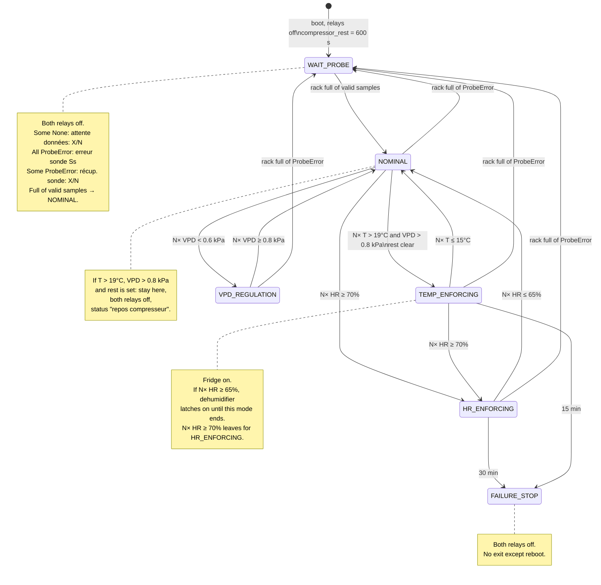

# Cabinet state machine

The controller keeps vapor-pressure deficit (VPD) between 0.6 kPa and 0.8 kPa, and keeps relative humidity at or below 70%. Two relays act on the cabinet:

- Fridge compressor: temperature falls, humidity rises, VPD falls. It cannot start while `compressor_rest` is set.
- Dehumidifier (Peltier): humidity falls, temperature rises, VPD rises. It has no rest time.

VPD is `es(T) * (1 - HR / 100)`, with `es(T) = 0.6108 * exp(17.27 * T / (T + 237.3))` in kPa.

A threshold changes a mode only when the sample rack is healthy and every stored sample meets that threshold. The rack is a `HistBuf` of capacity N, so the check covers all N slots. A failed read (bus error or bad CRC) is pushed as `ProbeError` and leaves the other slots in place.

In every mode except `FAILURE_STOP`, inspect the rack before any other rule. The rack is sick when it contains a `ProbeError` but is not full of them: take no decision until it is healthy again. Hold the mode and both relays. Deadline clocks keep running, and a deadline is applied only once every slot is a valid sample again. The rack is dead when every slot is `ProbeError`: switch to `WAIT_PROBE`. `FAILURE_STOP` does not read the rack and never leaves because of it.

`compressor_rest` is set for 600 s on every boot, and again whenever the fridge output falls from on to off. Commanding an already-off fridge does not restart the timer.

Boot starts in `WAIT_PROBE` with both relays off. The sample rack is empty, so the controller stays there until all N slots hold a valid sample, then switches to `NOMINAL`. `NOMINAL` tests these conditions on every slot, in this order:

1. Humidity at or above 70% → `HR_ENFORCING`.
2. Temperature above 19°C and VPD above 0.8 kPa, with rest clear → `TEMP_ENFORCING`.
3. Temperature above 19°C and VPD above 0.8 kPa, with rest set → stay in `NOMINAL`, both relays off, status `repos compresseur`.
4. VPD under 0.6 kPa → `VPD_REGULATION`.
5. Otherwise both relays off. Above 0.8 kPa with temperature at or below 19°C, moisture released in the cabinet is left to bring VPD down.

| Mode | Yellow title | Fridge | Dehumidifier | Leave when |
| --- | --- | --- | --- | --- |
| `WAIT_PROBE` | `ÉCHEC SONDE` | off | off | every slot a valid sample → `NOMINAL`. Status, in order: any slot `None` → `attente données : X / N` (X values present, N slots); every slot `ProbeError` → `erreur sonde (S s)` (S seconds since this `WAIT_PROBE` entry); otherwise some `ProbeError` → `récup. sonde X/N` (X remaining errors, N slots). |
| `NOMINAL` | `NOMINAL` | off | off | a rule above matches |
| `HR_ENFORCING` | `FORÇAGE HYGRO.` | off | on | N× HR ≤ 65%, or 30 min → `FAILURE_STOP` |
| `TEMP_ENFORCING` | `FORÇAGE TEMP.` | on | on only after N× HR ≥ 65%, then latched | N× HR ≥ 70% → `HR_ENFORCING`, else N× T ≤ 15°C → `NOMINAL`, or 15 min → `FAILURE_STOP` |
| `VPD_REGULATION` | `RÉGULATION HYGR.` | off | on | N× VPD ≥ 0.8 kPa. No time limit |
| `FAILURE_STOP` | `ÉCHEC / ARRÊT` | off | off | reboot only. Status `Durée forçage temp.` or `Durée forçage hygr.` |

Inside `TEMP_ENFORCING`, humidity is tested first. When all N samples are at or above 70%, the mode enters `HR_ENFORCING`: the fridge turns off, the dehumidifier stays or turns on, and the 30-minute deadline starts from that entry. That fridge falling edge sets `compressor_rest`. Rest does not block the handoff.

Deadlines start when the mode is entered. The `compressor_rest` flag may prevent switching to `TEMP_ENFORCING`. A sample rack full of `ProbeError` aborts the current mode into `WAIT_PROBE`, except from `FAILURE_STOP`. While the rack is only sick, the mode and the relays stay as they are. Recovery always re-enters `NOMINAL` once every slot is a valid sample again, and evaluates from there. Switching the fridge off on the way into `WAIT_PROBE` or `FAILURE_STOP` sets `compressor_rest`. A reboot returns to `WAIT_PROBE` and starts another 600-second rest.
